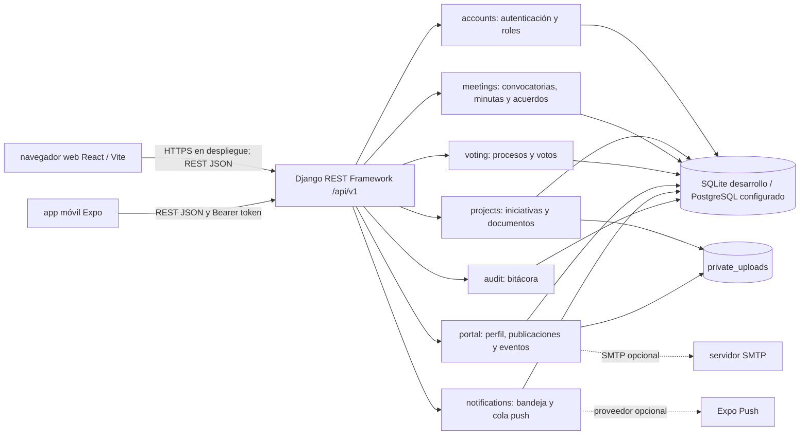
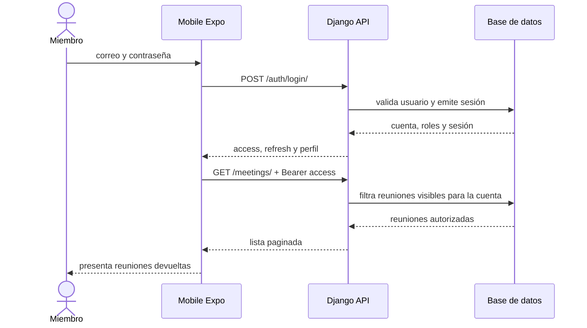
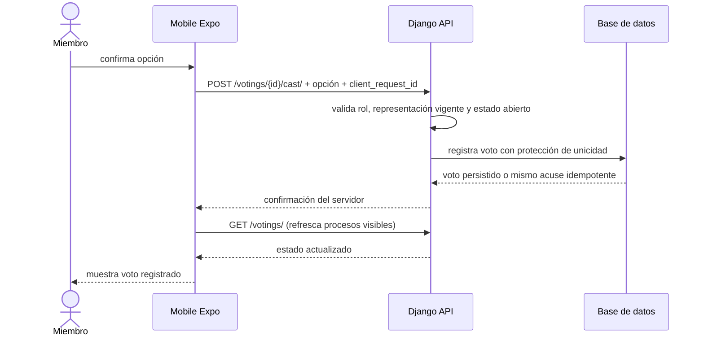
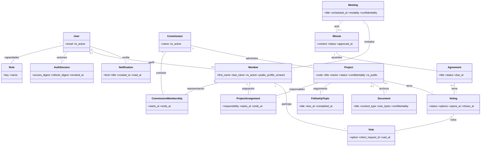

# Arquitectura y modelo actuales

Documento basado en los contratos y modelos que existen en el repositorio. El diagrama distingue los flujos conectados de las vistas que todavía conservan datos de demostración. No describe un despliegue productivo.

## Componentes



**Conectado actualmente:** web pública con recursos CMS y formularios; panel autenticado con lectura y actualización de estado de proyectos y edición del perfil institucional/publicaciones; Mobile con inicio/cierre de sesión, consulta privada de reuniones, proyectos, votaciones, avisos y metadatos de documentos, además de envío de voto y resultados cerrados. La conexión depende de `VITE_API_BASE_URL` o `EXPO_PUBLIC_API_BASE_URL` y de un backend accesible.

**Aún demostrativo:** edición/reordenamiento genérico de secciones CMS, CRUD completo de proyectos, gestión de eventos/medios y reuniones/minutas desde el panel, descarga de documentos en Mobile, notificaciones push, estadísticas y secciones de contenido web complementarias. El comportamiento de respaldo local debe identificarse como demostración.

## Secuencias principales

### Inicio de sesión móvil y consulta de reuniones



### Envío idempotente de voto



El UUID se genera una vez cuando se inicia un intento de voto y se conserva si se reintenta desde la pantalla de confirmación. El backend sigue siendo quien aplica el límite de un voto por miembro.

## Clases de dominio



## Modelo entidad-relación resumido

```mermaid
erDiagram
  USER ||--o{ AUTH_SESSION : abre
  USER }o--o{ ROLE : recibe
  USER ||--o| MEMBER : representa
  MEMBER ||--o{ COMMISSION_MEMBERSHIP : ocupa
  COMMISSION ||--o{ COMMISSION_MEMBERSHIP : contiene
  COMMISSION ||--o{ PROJECT : coordina
  PROJECT ||--o{ PROJECT_ASSIGNMENT : asigna
  MEMBER ||--o{ PROJECT_ASSIGNMENT : responsable
  PROJECT ||--o{ FOLLOW_UP_TOPIC : registra
  PROJECT ||--o{ DOCUMENT : adjunta
  MEETING ||--o| MINUTE : documenta
  MEMBER }o--o{ MEETING : recibe_convocatoria
  MINUTE ||--o{ AGREEMENT : contiene
  PROJECT o|--o{ VOTING : se_somete
  AGREEMENT o|--o{ VOTING : se_somete
  VOTING ||--o{ VOTE : recibe
  MEMBER ||--o{ VOTE : emite
  USER ||--o{ NOTIFICATION : recibe
  USER { int id PK; string email UK; bool is_active }
  ROLE { int id PK; string key UK; string name }
  AUTH_SESSION { int id PK; int user_id FK; string access_digest; string refresh_digest; datetime revoked_at }
  MEMBER { int id PK; int user_id FK; int institution_id FK; string first_name; string last_name; bool is_active }
  COMMISSION_MEMBERSHIP { int id PK; int member_id FK; int commission_id FK; date starts_at; date ends_at }
  PROJECT { int id PK; string code UK; string title; string status; string confidentiality; bool is_public }
  MEETING { int id PK; int commission_id FK; string title; datetime scheduled_at; string modality }
  MINUTE { int id PK; int meeting_id FK_UK; string status; datetime approved_at }
  AGREEMENT { int id PK; int minute_id FK; string title; string status }
  VOTING { int id PK; int commission_id FK; int project_id FK_NULL; int agreement_id FK_NULL; string status }
  VOTE { int id PK; int voting_id FK; int member_id FK; string option; uuid client_request_id }
  DOCUMENT { int id PK; int project_id FK_NULL; int minute_id FK_NULL; string title; string confidentiality }
```

La votación se relaciona con exactamente uno de `PROJECT` o `AGREEMENT`. El documento pertenece exactamente a un proyecto o minuta. `MINUTE.meeting_id` es único. El código fuente y migraciones conservan las restricciones completas, índices y campos restantes.

## Diccionario de datos clave

| Entidad | Campos relevantes | Regla de integridad |
| --- | --- | --- |
| `User` / `Role` | correo, estado, roles y capacidades | La API verifica sesión y capacidad en operaciones privadas. |
| `CommissionMembership` | miembro, comisión, inicio y fin de representación | El periodo no se superpone con otra representación del mismo miembro y comisión. |
| `Project` | código, título, sector, estado, confidencialidad, publicación | Solo información clasificada pública puede publicarse; la API verifica capacidad de publicación. |
| `Meeting` | comisión, agenda, fecha, modalidad, invitados | Fin no anterior al inicio; solo personas convocadas pueden registrar asistencia. |
| `Minute` / `Agreement` | reunión, contenido, aprobación, acuerdo y responsable | Hay una minuta por reunión; una minuta aprobada es inmutable. |
| `Voting` / `Vote` | estado, opciones, fechas, miembro, opción y UUID de solicitud | Tema único entre proyecto/acuerdo; voto único por miembro, con reintento idempotente. |
| `Document` | relación a proyecto o minuta, archivo y confidencialidad | Debe pertenecer a exactamente un padre y respetar el permiso de lectura. |
| `Notification` | destinatario, tipo, cuerpo y lectura | Una cuenta solo consulta y actualiza su propia bandeja. |

Para atributos adicionales, longitud, nulabilidad y valores permitidos, consultar los modelos en `Backend/accounts/`, `Backend/directory/`, `Backend/projects/`, `Backend/meetings/`, `Backend/voting/` y `Backend/notifications/`.

## Persistencia ACID

La integración conserva las transacciones y restricciones que ya implementa Django (por ejemplo, rotación de sesión y registro de votos) y no escribe directamente en la base desde los clientes. El navegador y Expo solo consideran persistida una operación después del acuse de API. SQLite es el perfil local; Compose configura PostgreSQL para pruebas compartidas. La durabilidad productiva depende de desplegar la base, respaldos y restauración descritos en [Backend/README.md](../Backend/README.md).
